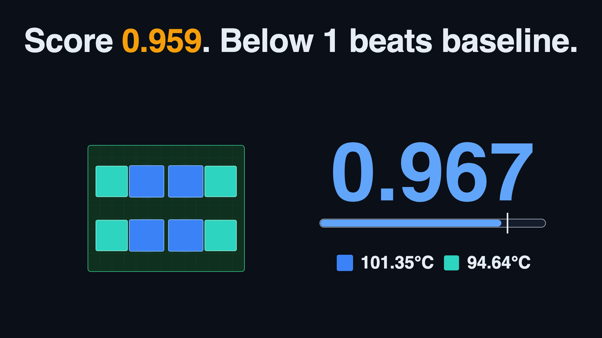
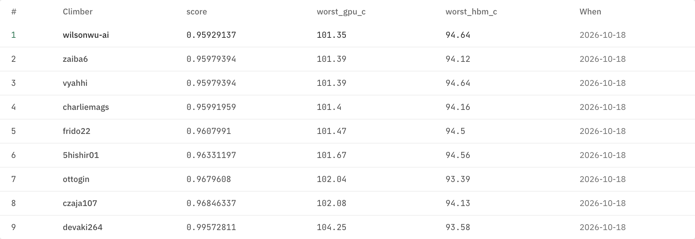
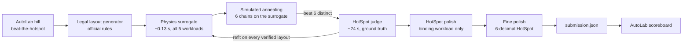

# ChipletChill: beat the hotspot

<!-- results:headline -->
**#1 on the AutoLab `beat-the-hotspot` leaderboard at 19:30 ET on 18 Oct: score 0.95929137** (seeded baseline 1.0, lower is better). Hottest GPU 101.35 C, hottest memory stack 94.64 C. Next: zaiba6 at 0.95979394.
<!-- /results:headline -->

**[Open the app](https://wilsonwu-ai.github.io/sundai-hack-145/)** · **[ELI5 explainer + video](https://wilsonwu-ai.github.io/sundai-hack-145/explainer.html)** · Built at [Sundai Hack 145](https://www.sundai.club), MIT CSAIL, 18 Oct 2026 · Track 2: *Design the coolest chiplet layout* · AutoLab hill [`czaja107/beat-the-hotspot`](https://app.autolab.ai/hills/czaja107/beat-the-hotspot)

[](https://wilsonwu-ai.github.io/sundai-hack-145/explainer.html)

## The challenge

Place 4 GPU dies (11.5 x 10.5 mm) and 4 HBM stacks (10.5 x 10.2 mm) on a 52 x 42 mm silicon interposer. Eight mandatory links (4 primary at 600 GB/s, max 5 mm; 4 secondary at 300 GB/s, max 6 mm) must route on a 0.5 mm grid, with sum(bandwidth x length) at most 13,500 GB/s·mm. Five fixed workloads. The cooler only makes good contact in a 44 x 34 mm central window. Score = the worse of the GPU and HBM temperature rises, each divided by the seeded random baseline's rise. Full rules: the hill README.

## Results

Every number below is a HotSpot result, never a surrogate estimate. The AutoLab rows are official runs. The surrogate-loop and random-layout rows come from our local run of the organizer's own pipeline (their verifier, trace generator and HotSpot inputs, on our build of the bundled HotSpot; `state/official/samples.jsonl`), which gave the same score as AutoLab on all eight of our submissions (`state/official/confirm.jsonl`, `state/official/samples.jsonl`).

<!-- results:board -->
| Run | Score (64 x 64) | Hottest GPU C | Hottest HBM C |
|---|---|---|---|
| **wilsonwu-ai (ours), AutoLab #1** | **0.95929** | 101.35 | 94.64 |
| zaiba6, AutoLab #2 | 0.95979 | 101.39 | 94.12 |
| vyahhi, AutoLab #3 | 0.95979 | 101.39 | 94.64 |
| charliemags, AutoLab #4 | 0.95992 | 101.40 | 94.16 |
| frido22, AutoLab #5 | 0.96080 | 101.47 | 94.50 |
| Ours, first AutoLab submission (HotSpot polish) | 0.96771 | 102.02 | 95.28 |
| Ours, surrogate loop v2 only | 0.97399 | 102.52 | 94.47 |
| Best of 66 random legal layouts | 0.97851 | 102.88 | 95.81 |
| Seeded random baseline | 1.0 | 104.59 | 97.68 |
<!-- /results:board -->

<!-- results:mesh128 -->
- **128 x 128 finalist check** (the hill's --final mesh, scored against its own 128 x 128 reference, so never compared with the 64 x 64 numbers above): 0.96501 for our polished layout, AutoLab a83faf5a (0.96231 at 64 x 64, GPU 101.95 C, HBM 94.92 C); 0.97053 for an earlier local layout (0.96784 at 64 x 64, GPU 102.39 C, HBM 95.31 C). On the finer mesh the polished layout beats the earlier one by 0.00552, so the polish is not a 64 x 64 artefact.
<!-- /results:mesh128 -->
- **Local judge calibration:** our macOS build of the bundled HotSpot reproduces the baseline exactly (104.59 / 97.68 C, score 1.0), see `scripts/official/calibrate.sh` and `state/official/calibration.jsonl`.
<!-- results:official -->
- **Official AutoLab runs:** 0.95929137 (experiment `28af609b`); 0.96180425 (experiment `6ebf27e1`); 0.96230682 (experiment `a83faf5a`); 0.96280940 (experiment `2a76bb6d`); 0.96343762 (experiment `70136bca`); 0.96406584 (experiment `2318b2e4`); 0.96481970 (experiment `5e7d6930`); 0.96582485 (experiment `f55862c8`); 0.96695565 (experiment `4a47cafc`); 0.96770951 (experiment `6f155606`). Each one is identical to our local judge.
<!-- /results:official -->



## How it works: trading accuracy for speed



1. **Ground truth.** `scripts/official/local_judge.py` is a local twin of the organizer's judge. About 24 s per layout for 5 workloads.
2. **Surrogate.** `scripts/official/lowfi.py` solves the same layer stack (interposer, die plane with gap material, TIM with the contact window, spreader, sink) on a 1 mm grid with the organizer's exact power maps and wire heat, about 0.13 s per layout (measured, `state/official/timing_lowfi.json`). An affine correction per die class and workload is refit on every HotSpot result. Rank correlation with HotSpot: 0.90 (Spearman) on the first 63 judged layouts (`state/official/corr_first63.txt`).
3. **Search.** `scripts/official/loop2.py`: annealing on the surrogate inside a 1.5 mm trust region around verified layouts, plus a kernel-weighted residual from nearby HotSpot results. v1 without these exploited surrogate error (predicted 0.952, HotSpot said 0.986 to 1.008, see `state/official/loop.jsonl`).
4. **Polish.** `scripts/official/polish.py`: the score is set by one die (G0 in `skewed_compute`), so candidate moves are screened with a single HotSpot run on that workload (one HotSpot run instead of five), and every improvement is confirmed by the full judge. 0.97399 to 0.96771.
<!-- results:fine -->
5. **Fine polish below the rounding step.** `scripts/official/fine.py`: the judge rounds die peaks to 0.01 C, so step 4 stalled on flat plateaus. `hp.py` runs a private HotSpot copy that prints 6 decimals (one format string changed, same solver). The search moves one die or a group of dies, screens on the binding workloads, re-checks the best few on all five, and keeps a move only if the unrounded worst case drops. The winning moves touched G0, H0, G1, H1, G2, H2, G3, H3. 0.96771 to 0.95929, confirmed by the unmodified judge and by AutoLab. This layout came from an OpenAI Codex agent we ran in parallel with the same tools, rules and seed layouts: it moved G0 up one HotSpot grid row (0.656 mm) and shifted the right-hand dies outward by 0.4 to 0.6 mm, using 13,499.7 of the 13,500 wire budget.
<!-- /results:fine -->

## The app

Drag dies on the interposer. Legality uses a TypeScript port of the organizer's rules (ports, A* router, budget), checked against their Python on 43 fixtures (20 legal, 23 illegal): same verdicts, same error text, identical routes. The live score and heat map come from a TypeScript port of the surrogate (labelled as an estimate). Load our best public layout, download a valid `submission.json`, or upload your own.

## Run it

```bash
npm install
npm run dev            # app at http://localhost:5173/sundai-hack-145/
npm test               # 54 unit tests (official rules + surrogate port)
npm run test:e2e       # Playwright, desktop + mobile
bash video/render.sh   # re-render the explainer video from video/data.json
```

The Python pipeline needs the organizer repo cloned into `.official/sim` (gitignored, not redistributed here):

```bash
git clone https://github.com/Czaja107/chiplet-thermal-simulator .official/sim
bash scripts/official/calibrate.sh                     # builds HotSpot, checks the baseline
python3 scripts/official/train_and_search.py sample 60  # HotSpot training data
python3 scripts/official/loop2.py --rounds 6
python3 scripts/official/polish.py state/official/subs/<best>.json --dies G0,H0,H3,G3,G1
```

## Honest limits

- The surrogate is a 1 mm low-fidelity model with a learned affine correction. Its numbers in the app are estimates; every ranking number above is HotSpot.
- Our local HotSpot is built from the organizer's bundled source on macOS, not their pinned Linux binary. It matches the baseline to the published precision.
<!-- results:limits -->
- We lead by 4 rounding steps at 19:30 ET: 101.35 C against 101.39 C on the hottest GPU. The judge rounds every die temperature to 0.01 C, so the board moves in steps of 0.000126.
- The exact layouts behind 0.96482, 0.96407, 0.96344, 0.96281, 0.96231, 0.96180, 0.95929 are held back until the hack ends, so nobody starts from them mid-race. The app and `src/official/data/best.json` carry our best public layout (0.96582); the held layouts are small moves from it, so some die positions match. Every score above is official either way.
- The last stage ranks candidates on unrounded HotSpot output from a private build. Every number we report comes from the unmodified judge and from AutoLab. HotSpot's default stopping rule leaves about 0.0023 C of error on G0, the binding die, measured on three layouts from this stage (`state/official/convergence_check.json`), much smaller than the 0.67 C this stage found.
<!-- /results:limits -->
- Rankings on this page are 64 x 64, the AutoLab leaderboard mesh. The hill's finalist check uses 128 x 128 against its own reference, and other teams' layouts are not public, so we can run only our own layouts there.
- These are benchmark temperatures, not calibrated junction predictions (see the hill README).

## Credits and license

Challenge, simulator and data: [Czaja107/chiplet-thermal-simulator](https://github.com/Czaja107/chiplet-thermal-simulator) and [chiplet-thermal-gui](https://github.com/Czaja107/chiplet-thermal-gui). Thermal solver: [HotSpot](https://github.com/uvahotspot/HotSpot). Platform: [AutoLab](https://app.autolab.ai). Event: [Sundai Club](https://www.sundai.club). The files in `src/official/data/` come from the organizer's repo and are not covered by this repo's license (see `src/official/data/NOTICE.md`). Everything else: [MIT](LICENSE).
