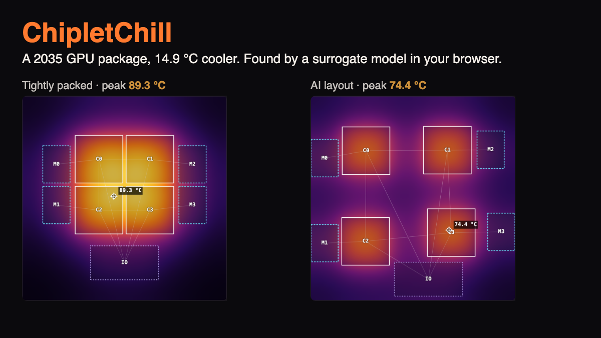
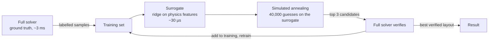

# ChipletChill

**A 2035 GPU package that runs 14.9 °C cooler (best of 3 seeds; mean 14.8 °C), found by a surrogate model in your browser.**
On the training workload the hottest spot drops from **89.3 °C to 74.4 °C** using 150 full thermal solves. A solver-only annealing search given **10× that budget** (1,500 solves, one run) lands slightly worse, at 74.8 °C.

**[Open the app](https://wilsonwu-ai.github.io/sundai-hack-145/)** · **[How it works, ELI5](https://wilsonwu-ai.github.io/sundai-hack-145/explainer.html)** · Built at [Sundai Hack 145](https://www.sundai.club), MIT CSAIL, 18 Oct 2026 · Track 2: *Design the coolest chiplet layout*



## Results

Each workload runs the same package (4 compute dies at 300 W, 4 HBM stacks at 30 W, 1 IO die at 40 W: 1.36 kW on a 60 × 60 mm interposer) under the same wire budget. Loop numbers are the mean of seeds 1 to 3, with the best seed in brackets. Every temperature is the **full solver's** verdict on the final layout, never the surrogate's guess.

| Workload | Start (packed) | Surrogate loop, 150 solves | Solver only, 150 solves | Solver only, 1,500 solves | Surrogate MAE |
|---|---|---|---|---|---|
| Training | 89.3 °C | **74.5 (74.4) °C** | 78.7 °C | 74.8 °C | 0.15 °C |
| Inference prefill | 81.1 °C | **68.6 (68.5) °C** | 72.2 °C | 69.0 °C | 0.13 °C |
| Inference decode | 60.6 °C | **54.0 (54.0) °C** | 55.9 °C | 54.4 °C | 0.17 °C |

Reproduce: `npx vite-node scripts/benchmark.ts`. It writes [`state/results.json`](state/results.json). The loop takes about 1.8 s per run on an M-series laptop; the 1,500-solve solver-only run takes about 4.6 s.

## ELI5

Four hot burners sit under one frying pan. The pan spreads the heat, so burners pushed close together make one scorching spot in the middle. Move them apart and each glow fades before it meets the next. But the burners are tied together with short strings (the wires between chips), so you can't just shove them into the corners. The game is to find where to put them so the hottest spot is as cool as it can be while the strings still reach. A computer that checks one arrangement exactly is slow, so we teach a quick guesser to rule out the bad ideas first, and only check the promising ones for real.

## How it works



1. **Ground truth: a 2D heat-spreading solver** (`src/engine/solver.ts`). The package is a plate (die + copper lid lumped into k·t) cooled from above by a cold plate: `k·t ∇²T − h (T − T_amb) + q = 0` with insulated edges. Finite volumes on a 48 × 48 grid, solved by Jacobi-preconditioned conjugate gradients. Frozen tests check it against the closed-form uniform case, energy balance, mirror symmetry and linearity in power.
2. **The insight: heat adds up linearly.** At steady state, temperature is the sum of each chiplet's own "glow", which fades over the spreading length `L = √(k·t / h) ≈ 6.7 mm`, plus mirror images at the insulated edges. The surrogate's 15 features (`src/engine/features.ts`) are those summed glows, computed with a K0 kernel at several points inside every chiplet. Ridge regression on top of them (λ chosen by exact leave-one-out) misses the full solver by 0.15 °C on average on the layouts the optimizer proposed (and within 2 °C on random held-out layouts, the test threshold).
3. **The loop** (`src/engine/optimize.ts`). Spend 40% of the solver budget on diverse legal layouts, train, then repeat: anneal on the surrogate, verify the top candidates with the full solver, add them to the training set, retrain.
4. **The constraint that keeps it honest** (`src/engine/constraints.ts`). Without it, the coolest layout is trivial: fling the hot dies into the corners. Every layout must keep its total die-to-die, die-to-HBM and die-to-IO link length within 1.3× the packed default, and no two chiplets may come within 1 mm.

## In the app

- **Beat the AI:** drag the chiplets yourself. The heat map re-solves live, with the wire budget and legality shown as you move.
- **Run AI optimizer:** watch the surrogate loop and a solver-only baseline race on the same budget, with the heat map following the best verified layout.
- **Workloads:** training, inference prefill (compute-bound) and inference decode (memory-bound).
- **Cooling:** a cold plate or in-chip microfluidics.

## Why we built this

We weighed six ideas across both tracks ([docs/ideas.md](docs/ideas.md)) and picked Track 2. It has a ground-truth solver, so every claim can be checked rather than argued. It reduces to one number. And it runs entirely client-side, so it ships as a static site. Full STAR write-up: [docs/why.md](docs/why.md).

## Honest limits

- A 2D plate, not a 3D stack: it captures lateral spreading and hotspot coupling (which is what layout changes), not vertical stacks or TSVs.
- The HBM stacks' own, lower temperature limit is not modelled as a separate constraint.
- The per-workload compute vs HBM power split is an assumption that only encodes the direction (decode is memory-bound). Sources and unsourced items are listed in [research/brief.md](research/brief.md).
- 2035 power figures are projections from current roadmaps, not specs.

## Prior art

The loop follows the same shape as [TACPAs (2025)](https://arxiv.org/html/2504.03808v1): a surrogate predicts peak temperature and simulated annealing searches, with the solver verifying. Related work: [DiffChip](https://arxiv.org/html/2502.16633v1), [RLPlanner](https://arxiv.org/abs/2312.16895), [TAP-2.5D](https://past.date-conference.com/proceedings-archive/2021/html/1516.html), [DeepOHeat](https://arxiv.org/abs/2302.12949v1). What's different here: it runs in a browser tab in about two seconds, and the wire budget is a hard constraint rather than a weighted penalty.

## Run it

```bash
npm install
npm run dev          # app at http://localhost:5173/sundai-hack-145/
npm test             # 18 unit tests: solver physics + optimizer guarantees
npm run test:e2e     # Playwright, desktop + mobile
npx vite-node scripts/benchmark.ts
```

Vite + TypeScript, no runtime dependencies besides GSAP for the explainer animations. CI runs typecheck, unit and end-to-end tests on every push, and deploys to GitHub Pages only when they pass.

```
src/contracts.ts        shared types
src/engine/solver.ts    ground-truth thermal solver (frozen)
src/engine/presets.ts   2035 package + workloads (frozen)
src/engine/constraints  wire budget + legality (frozen)
src/engine/features.ts  physics-informed surrogate features
src/engine/surrogate.ts ridge regression, LOO-tuned
src/engine/optimize.ts  surrogate loop + solver-only baseline
src/ui/                 heat map, drag, chart, app
public/explainer.html   ELI5, motion graphics, diagram
```

## License

[MIT](LICENSE)
